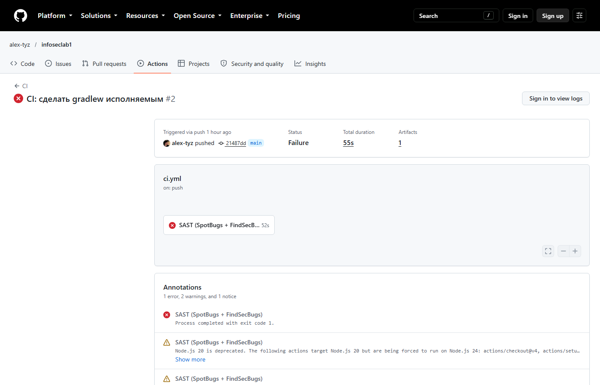

# Secure REST API

Java 17, Spring Boot 4.1, H2, JWT, bcrypt.

## API

| Метод | Путь | Доступ |
|---|---|---|
| POST | `/auth/login` | публичный, выдаёт JWT |
| GET | `/api/data` | JWT |
| POST | `/api/notes` | JWT |
| GET | `/api/notes` | JWT |

```bash
curl -X POST http://localhost:8080/auth/login -H "Content-Type: application/json" -d '{"username":"admin","password":"<пароль>"}'
curl http://localhost:8080/api/data -H "Authorization: Bearer <token>"
```

## Меры защиты

- **SQLi:** запросы через `JdbcTemplate` с параметрами `?`, без конкатенации строк.
- **XSS:** данные в ответах экранируются `HtmlUtils.htmlEscape`, заголовки CSP и `nosniff`.
- **Аутентификация:** пароли хранятся как хэши bcrypt; при входе выдаётся JWT (HS256, 15 минут); middleware `JwtAuthFilter` возвращает 401 без действительного токена.

## Отчёты SAST/SCA

SpotBugs до и после исправления:




Snyk:


## Последний успешный запуск pipeline

https://github.com/alex-tyz/infoseclab1/actions/runs/38292583155
