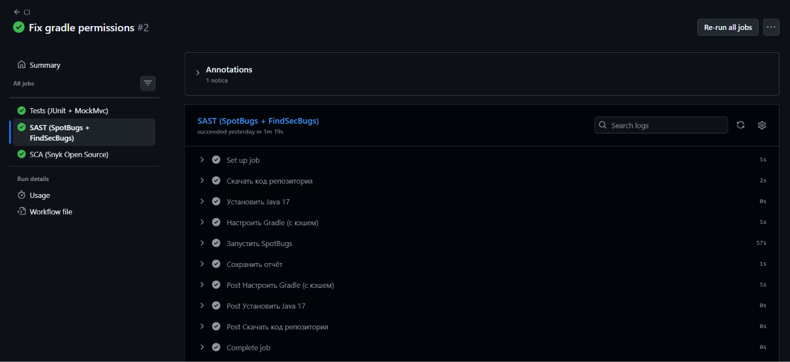
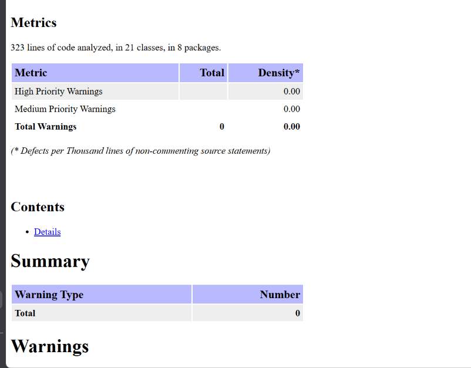
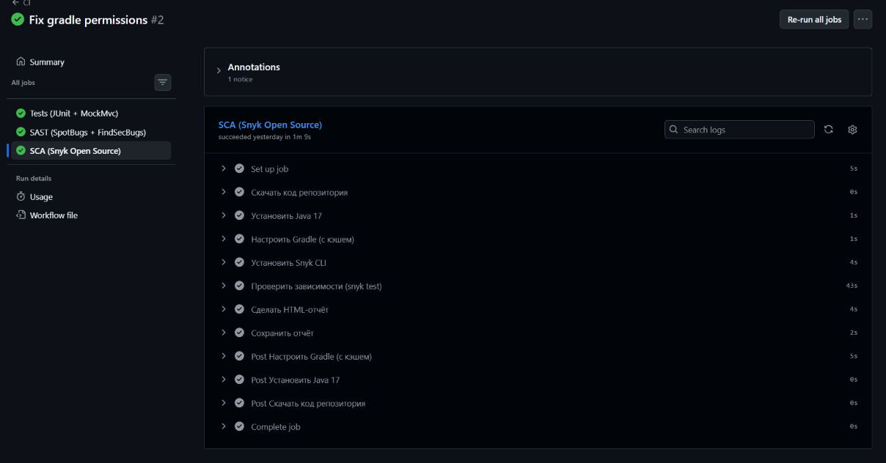
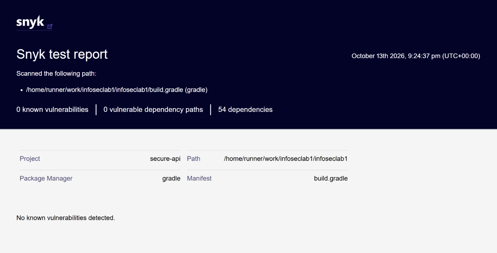

# Secure REST API

REST API с JWT-аутентификацией. Стек: Java 17, Spring Boot 4.1, H2, Spring JDBC, JJWT, bcrypt.

## API

Все ответы в JSON, ошибки в формате `{"error": "..."}`.

| Метод | Путь | Доступ | Описание |
|---|---|---|---|
| POST | `/auth/login` | публичный | вход по логину и паролю, возвращает JWT |
| GET | `/api/data` | JWT | текущий пользователь и список пользователей (без хэшей паролей) |
| POST | `/api/notes` | JWT | создать заметку от имени текущего пользователя |
| GET | `/api/notes` | JWT | заметки только текущего пользователя |

### POST /auth/login

```bash
curl -X POST http://localhost:8080/auth/login \
  -H "Content-Type: application/json" \
  -d '{"username":"admin","password":"<пароль>"}'
```

- `200` — `{"token":"eyJ...","tokenType":"Bearer"}`
- `401` — неверный логин или пароль
- `400` — нет логина или пароля

### GET /api/data

```bash
curl http://localhost:8080/api/data -H "Authorization: Bearer <token>"
```

```json
{"currentUser":"admin","users":[{"id":1,"username":"admin"},{"id":2,"username":"user"}]}
```

### POST /api/notes и GET /api/notes

```bash
curl -X POST http://localhost:8080/api/notes \
  -H "Authorization: Bearer <token>" -H "Content-Type: application/json" \
  -d '{"title":"Первая","content":"Привет"}'
# 201 {"status":"created"}

curl http://localhost:8080/api/notes -H "Authorization: Bearer <token>"
# 200 [{"id":1,"title":"Первая","content":"Привет","createdAt":"..."}]
```

Без токена или с неверным/истёкшим токеном любой метод `/api/*` возвращает `401`.

## Меры защиты

### SQL Injection

Все запросы к БД выполняются через `JdbcTemplate` с параметрами `?` (PreparedStatement). Данные передаются в БД отдельно от текста запроса и не могут изменить его. Конкатенации строк в SQL нет:

```java
jdbc.query("SELECT id, username, password_hash FROM users WHERE username = ?", USER_ROW_MAPPER, username);
```

Попытка входа с логином `admin' OR '1'='1` возвращает `401`.

### XSS

- Пользовательские данные экранируются перед отправкой в ответе (`HtmlUtils.htmlEscape`): заметка `<script>alert(1)</script>` возвращается как `&lt;script&gt;alert(1)&lt;/script&gt;` и не выполнится в браузере.
- Все ответы содержат заголовки `Content-Security-Policy: default-src 'none'`, `X-Content-Type-Options: nosniff`, `X-Frame-Options: DENY`.

### Аутентификация

- **Пароли** хранятся только как хэши bcrypt (`BCryptPasswordEncoder`, cost 12), в БД нет колонки с паролем.
- **JWT** выдаётся при успешном входе: подпись HS256, срок жизни 15 минут, секретный ключ берётся из переменной окружения и в репозитории отсутствует.
- **Middleware** `JwtAuthFilter` проверяет токен перед каждым запросом к контроллерам. Без токена доступен только `/auth/login`, остальные пути возвращают `401`. Имя пользователя берётся из проверенного токена, поэтому пользователь видит только свои заметки.
- Неверный пароль и несуществующий пользователь дают одинаковый ответ, по нему нельзя узнать, существует ли логин.

## Отчёты SAST/SCA

Pipeline `.github/workflows/ci.yml` запускается на каждый push и pull request в `main` и падает при найденных проблемах.

### SAST: SpotBugs + Find Security Bugs

SpotBugs нашёл `CT_CONSTRUCTOR_THROW` в `JwtService` (исправлено: класс сделан `final`) и ложное срабатывание `EI_EXPOSE_REP2` (подавлено в `config/spotbugs/exclude.xml`).





### SCA: Snyk

Snyk нашёл уязвимости в зависимостях Spring Boot 4.1.1 (Tomcat — Critical, Jackson — High). Версии обновлены в `build.gradle`, после чего проверка проходит.




## Последний успешный запуск pipeline

https://github.com/alex-tyz/infoseclab1/actions/runs/38292583155
